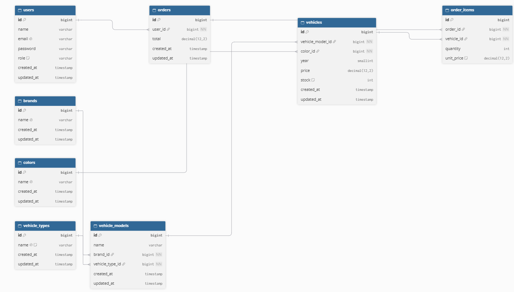

# car-hub

CarHub es una aplicación web de vehículos que incluye gestión de inventario CRUD, seguimiento de stock por parte del administrador, compras de clientes y recomendaciones de automóviles personalizadas.

## Modelo de base de datos

